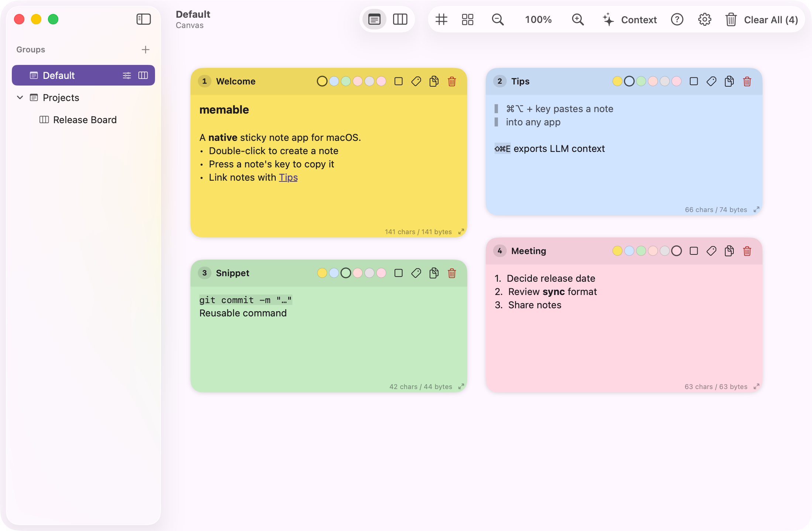

# memable


A temporary copy-and-paste sticky-note app for macOS, written in Swift / SwiftUI.



## Features
- Create, edit, delete, copy, move and resize sticky notes on a large zoomable canvas
- **Markdown notes**: headings, lists, quotes, code, bold, links and `[[internal links]]` are previewed; click a note to edit its source
- **Key IDs**: every note gets a key (1–9, 0, a–z). Press it to copy the note
- **Global Quick Paste**: `⌘⌥ + key` copies a note and pastes it into the frontmost app, even when memable is in the background
- **Groups** in a sidebar: nest, reorder by drag & drop, rename, delete
- **Kanban mode** per group with custom steps between the fixed ToDo / Done columns, plus free notes on the board
- **Image notes** via paste (`⌘V`) or drag & drop; double-click to enlarge
- **LLM Context Export**: copy or save selected notes, a group, or a group tree as structured Markdown
- **Metadata**: stable IDs, titles, tags, source URLs, created/updated timestamps
- **Multi-device sync** through any folder (Dropbox, iCloud Drive …), one Markdown file per note, with live reload
- Grid snap, align notes, undo delete (`⌘Z`), light / dark / system appearance
- JSON backup import / export (compatible with the earlier Electron / web versions)

## Requirements
- macOS 14 Sonoma or later
- To build: Xcode 16 or later (Swift 5.10+ toolchain)

## Installation
Download the latest `memable-x.y.z-macos.zip` from [GitHub Releases](https://github.com/TetsuakiBaba/memable/releases), unzip it and move `memable.app` to `/Applications`.

## Build from source
```bash
swift build                 # debug build
swift test                  # unit tests (data model, file formats, export)
scripts/build-app.sh        # → build/memable.app and build/memable-<version>-macos.zip
```

`build-app.sh` options (environment variables):

| Variable | Default | Purpose |
| --- | --- | --- |
| `UNIVERSAL=1` | off | Build arm64 + x86_64 |
| `CODESIGN_IDENTITY` | `-` (ad-hoc) | e.g. `Developer ID Application: …` for distribution |
| `BUNDLE_ID` | `com.tetsuakibaba.memable` | Bundle identifier |

The app version is kept in [`VERSION`](./VERSION).

## Releasing

### One-time setup
1. A **Developer ID Application** certificate in the login keychain (`security find-identity -v -p codesigning`).
2. An **App Store Connect API key** for notarization:
   1. [App Store Connect](https://appstoreconnect.apple.com/access/integrations/api) → Users and Access → Integrations →
      App Store Connect API → **Team Keys** → Generate API Key (access: *Developer*).
   2. Download `AuthKey_<KEY_ID>.p8` (it can only be downloaded once) and note the **Key ID** and **Issuer ID**.
   3. Keep the key outside the repository:
      ```bash
      mkdir -p ~/.appstoreconnect/private_keys
      mv ~/Downloads/AuthKey_<KEY_ID>.p8 ~/.appstoreconnect/private_keys/
      chmod 600 ~/.appstoreconnect/private_keys/AuthKey_<KEY_ID>.p8
      ```
   4. Store it as a keychain profile used by `scripts/notarize.sh`:
      ```bash
      xcrun notarytool store-credentials memable-notary \
          --key ~/.appstoreconnect/private_keys/AuthKey_<KEY_ID>.p8 \
          --key-id <KEY_ID> --issuer <ISSUER_ID>
      ```
      Alternatively (e.g. on CI) set `ASC_KEY_PATH`, `ASC_KEY_ID` and `ASC_ISSUER_ID` instead of using the profile.
3. GitHub CLI logged in with push access: `gh auth status`.

### Each release
1. Bump [`VERSION`](./VERSION) (e.g. `2.0.1`) and commit on `main`.
2. Run:
   ```bash
   scripts/release.sh
   ```
   This runs the tests, builds a universal (arm64 + x86_64) app signed with Developer ID,
   notarizes it with the App Store Connect API key and staples the ticket, pushes the `vX.Y.Z` tag and creates a **draft** GitHub release
   with `memable-X.Y.Z-macos.zip` attached.
3. Open the draft on GitHub, edit the release notes and press **Publish release**.

The steps can also be run one by one: `CODESIGN_IDENTITY="Developer ID Application: …" UNIVERSAL=1 scripts/build-app.sh`,
`scripts/notarize.sh`, then `gh release create vX.Y.Z build/memable-X.Y.Z-macos.zip --draft --generate-notes`.

## Usage
See [docs/MANUAL.md](./docs/MANUAL.md) or **Help → memable Help** in the app.

## Data storage

Notes are stored in a folder with an LLM-friendly layout — by default
`~/Library/Application Support/com.tetsuakibaba.memable/library`, or the sync folder chosen in **Settings → Storage**:

```text
library/
├── notes/       # One Markdown file per note, with JSON-valued frontmatter
├── assets/      # Image-note files
├── groups.json
├── layout.json  # Positions, sizes, colors, and stacking order
└── index.json
```

- The format is the same one the Electron version (≤ 1.7) wrote to its sync folder, so existing sync folders open as-is.
- Dropbox / iCloud conflict copies (`id (… conflicted copy …).md`) are ignored instead of showing up as duplicate notes.
- Legacy `notes.json` folders and older JSON backups are still importable.

### Migrating from the Electron version
- If the Electron app was syncing to an external folder, the native app picks up that folder automatically on first launch.
- Otherwise, export a JSON backup from the old app (**Settings → Export JSON**) and import it in the new one (**File → Import JSON…**).
- Global shortcuts post `⌘V` to other apps, which needs **System Settings → Privacy & Security → Accessibility** permission for memable.

## Project layout
```text
Sources/MemableCore/   Data model, normalization, note file format, sync folder, Markdown parser, context export
Sources/Memable/       SwiftUI app (store, views, global hot keys, clipboard, folder watcher)
Tests/                 Unit tests for MemableCore
scripts/               build-app.sh, notarize.sh, release.sh
docs/                  Manual, screenshot, sample backup
icons/                 Icon sources
```

## License
This project is licensed under the MIT License. See `LICENSE` for details.
